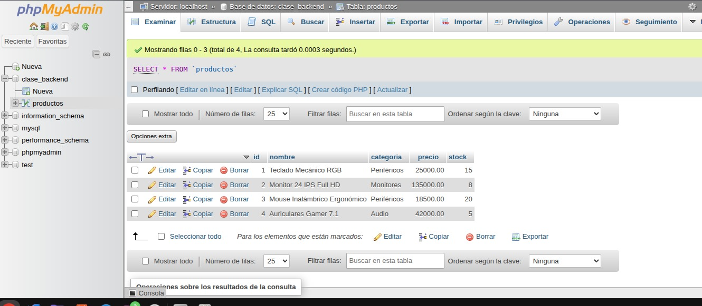
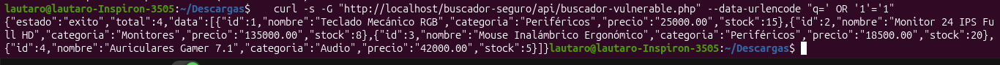
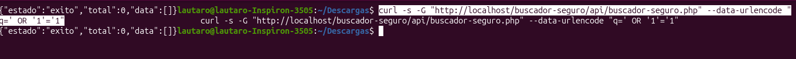
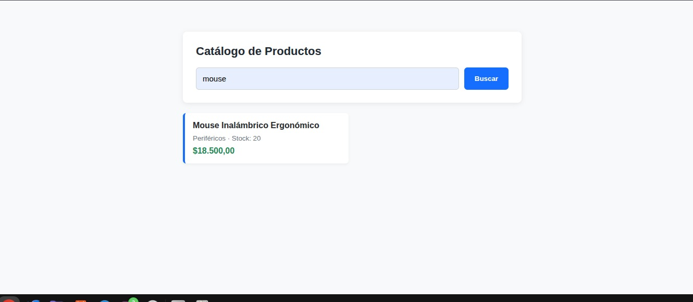

# AA21 - Buscador seguro con PDO y consultas preparadas

Módulo backend en **PHP + PDO** con un frontend en **JavaScript Vanilla (`fetch`)**, ejecutado sobre **XAMPP para Linux** (Apache + MariaDB). El objetivo es analizar un buscador vulnerable a **inyección SQL** y reemplazarlo por uno seguro con **consultas preparadas**.

## Estructura

```
├── index.html                      Interfaz del buscador
├── css/styles.css                  Estilos
├── js/app.js                       Frontend: fetch hacia la API
├── api/
│   ├── buscador-vulnerable.php     ❌ Versión original (concatena el SQL)
│   └── buscador-seguro.php         ✅ Versión segura (PDO + prepared statements)
├── config/conexion.php             Conexión PDO a MySQL
├── sql/productos.sql               Base de datos y datos de prueba
└── docs/capturas/                  Capturas de este README
```

## Cómo ejecutarlo en XAMPP

1. Iniciar Apache y MySQL (`sudo /opt/lampp/lampp start`).
2. Copiar el proyecto a `/opt/lampp/htdocs/buscador-seguro/`.
3. Ejecutar `sql/productos.sql` en phpMyAdmin (crea la base `clase_backend` y la tabla `productos`).
4. Abrir `http://localhost/buscador-seguro/`.

---

## 1. Base de datos cargada en phpMyAdmin



Se ejecutó el SQL provisto en phpMyAdmin. Se creó la base `clase_backend` con la tabla `productos` (id, nombre, categoría, precio, stock) y los **4 productos** de prueba: Teclado Mecánico RGB, Monitor 24 IPS Full HD, Mouse Inalámbrico Ergonómico y Auriculares Gamer 7.1.

## 2. Análisis del buscador vulnerable



El archivo `api/buscador-vulnerable.php` arma la consulta concatenando directamente lo que escribe el usuario:

```php
$sql = "SELECT * FROM productos WHERE nombre LIKE '%" . $q . "%'";
$resultado = $pdo->query($sql);
```

Se envió el texto `' OR '1'='1` como búsqueda:

```bash
curl -s -G "http://localhost/buscador-seguro/api/buscador-vulnerable.php" --data-urlencode "q=' OR '1'='1"
```

La consulta que ejecuta la base queda así:

```sql
SELECT * FROM productos WHERE nombre LIKE '%' OR '1'='1%'
```

La comilla simple cierra el `LIKE` antes de tiempo y `'1'='1'` es siempre verdadero, por lo que el filtro deja de funcionar. La respuesta devolvió `"total":4`: **los 4 productos**, aunque ninguno se llama `' OR '1'='1`.

**Por qué es grave:** la entrada del usuario se interpreta como código SQL. Con la misma técnica, un atacante podría usar `UNION SELECT` para leer otras tablas, o inferir datos internos de la base.

## 3. Versión segura con PDO y consultas preparadas

El archivo `api/buscador-seguro.php` separa **el código SQL** de **los datos**:

```php
$sql = "SELECT id, nombre, categoria, precio, stock
        FROM productos
        WHERE nombre LIKE :q_nombre OR categoria LIKE :q_categoria
        ORDER BY nombre ASC";

$stmt = $pdo->prepare($sql);
$stmt->execute([
    ':q_nombre'    => "%{$q_escapado}%",
    ':q_categoria' => "%{$q_escapado}%",
]);
```

Medidas aplicadas:

| Medida | Para qué sirve |
|---|---|
| **Consulta preparada con parámetros nombrados** (`:q_nombre`) | El valor viaja aparte del SQL: la base lo trata siempre como texto, nunca como código. |
| **`PDO::ATTR_EMULATE_PREPARES => false`** | Fuerza prepared statements reales del motor, no emulados por PHP. |
| **Escape de comodines `%` y `_`** | El usuario no puede alterar el patrón del `LIKE`. |
| **Validación de entrada** | Solo se acepta `GET`, el parámetro debe ser texto y de máximo 100 caracteres. |
| **Errores genéricos al cliente** | El detalle técnico se guarda en el log del servidor y no se expone. |
| **`textContent` en el frontend** | Evita XSS al mostrar los resultados en el DOM. |

Se repitió exactamente el mismo ataque contra la versión segura:

```bash
curl -s -G "http://localhost/buscador-seguro/api/buscador-seguro.php" --data-urlencode "q=' OR '1'='1"
```



Con esta versión, el texto `' OR '1'='1` se busca como una frase literal: ningún producto la contiene, por lo que la respuesta es `"total":0` y **0 resultados**. La inyección SQL quedó neutralizada.

> Nota: buscar `or` o `1` sí devuelve productos, y es correcto. No es una inyección: son coincidencias normales del `LIKE` ("Monit**or**", "Gamer 7.**1**").

## 4. Buscador funcionando



El frontend (`js/app.js`) envía la búsqueda con `fetch` al endpoint seguro y renderiza las tarjetas de producto. Al buscar `mouse` devuelve el **Mouse Inalámbrico Ergonómico**, con su categoría, stock y precio.

## Autor

Lautaro González
